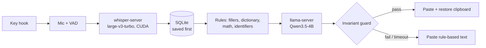

<p align="center">
  
</p>

<h1 align="center">Voxora</h1>

<p align="center">
  Hold a key, speak, release: clean text appears in any Windows app.<br>
  Speech recognition and AI cleanup run on your own GPU. No account, no subscription, no audio leaves the PC.
</p>

<p align="center">
  <a href="https://github.com/ParshvCrafts/Voxora/actions/workflows/ci.yml"></a>
  <a href="LICENSE"></a>
  
</p>

<p align="center">
  
</p>

Voxora is a local-first alternative to cloud dictation tools like Wispr Flow. It is built for
people who dictate into code editors, AI chats and LaTeX as often as into email: it keeps
`snake_case` identifiers intact, knows that "FAISS" is not "phaistense", resolves "Tuesday at
2, actually no, Wednesday" to Wednesday, and turns *"sigma from i equals 1 to n of x sub i"*
into `\sum_{i=1}^{n} x_i`.

## What it does

- **One key, two gestures.** Hold Right Alt to talk; tap it for hands-free mode, which stops
  when you pause. `Esc` cancels. The floating pill never steals focus from your editor.
- **Context-aware modes.** Clean, Technical, Math/LaTeX, Concise, Professional, Verbatim. The
  mode follows the foreground app (VS Code/Cursor → Technical, Overleaf → Math, Gmail →
  Professional) using only the process name and window title.
- **Spoken math and code.** A deterministic parser renders math as Unicode (`θᵀx + b = 0`) or
  LaTeX (`\frac{df}{dx}`, `P(Y = 1 \mid X)`); "camel case get user by id" becomes `getUserById`.
- **AI cleanup that cannot change your facts.** A local LLM removes fillers and resolves
  self-corrections, then an invariant guard rejects any rewrite that adds or drops a number
  or identifier, introduces a name you never said, or answers your question instead of
  transcribing it. Rejected rewrites
  fall back to the rule-based text.
- **Nothing gets lost.** Every transcript is committed to SQLite before it is pasted. Your
  clipboard (text or image) is restored after the paste. Admin windows that block synthetic
  input get the text on the clipboard with a notice instead of a silent failure.
- **Personal dictionary.** Terms bias Whisper toward your spellings and fix casing afterwards
  ("lang graph" → LangGraph); replacements double as snippets.

<p align="center">
  
</p>

## How it works



- **Rust + Tauri 2** shell (4.5 MB installer, ~55 MB RAM) with a Win32 low-level keyboard hook,
  WASAPI capture via `cpal`, the pure-Rust [earshot](https://crates.io/crates/earshot) VAD for
  live endpointing, and clipboard/`SendInput` injection.
- **Inference runs in official prebuilt CUDA servers** from whisper.cpp and llama.cpp, started
  and supervised by Voxora on `127.0.0.1`. No CUDA toolkit needed to build, a crash in inference
  cannot take down the hotkey process, and any OpenAI-compatible server (Ollama, LM Studio) can
  replace the built-in rewrite engine.
- **The LLM is optional by design.** Short, fluent utterances skip it (the rules already produce
  final text in under 1 ms); a timeout or guard violation also falls back to the rules.
- **Measured, not assumed.** Every default (model choice, vocabulary prompt, fast path) has a
  benchmark behind it in the decision log, including ideas that were tried and dropped.

Deeper dive: [docs/ARCHITECTURE.md](docs/ARCHITECTURE.md) · decision log with evidence:
[docs/DECISIONS.md](docs/DECISIONS.md).

## Results

Measured on a Lenovo Legion 5i (i9-14900HX, RTX 4060 Laptop 8 GB, Windows 11). Full tables and
how to reproduce: [docs/BENCHMARKS.md](docs/BENCHMARKS.md).

| | Result |
|---|---|
| Quality benchmark (30 cases: fillers, self-corrections, ML jargon, code, math, prompt injection; synthesized speech) | **29/30 pass** |
| Speech recognition, warm (whisper large-v3-turbo Q8) | P50 166 ms, P95 245 ms |
| AI rewrite when used (Qwen3.5-4B Q4_K_M) | P50 357 ms, P95 929 ms |
| End-to-end, key release → text in app (real app, release build, 7 dictations) | 0.45–0.77 s rule-based, 0.85–1.24 s with AI rewrite |
| 5 s of silence | nothing inserted |
| GPU memory, both models loaded | 4.3 GB of 8 GB |

## Quick start

1. Download `Voxora_x.y.z_x64-setup.exe` from [Releases](https://github.com/ParshvCrafts/Voxora/releases) and run it.
2. On first launch click **Download and start**. Voxora fetches pinned, SHA-256-verified builds
   of whisper.cpp, llama.cpp and the models (~4.7 GB download with an NVIDIA GPU).
3. Click into any text field, hold **Right Alt**, speak, release.

Requirements: Windows 10/11 x64. NVIDIA GPU with about 5 GB of free VRAM recommended (both models use 4.3 GB); without one Voxora
uses CPU builds (slower) and you can turn off the AI rewrite for instant rule-based cleanup.

| Shortcut | Action |
|---|---|
| Hold Right Alt | Push-to-talk |
| Tap Right Alt | Hands-free on; tap again or pause to finish |
| Esc (while recording) | Cancel |
| Ctrl+Alt+M | Cycle mode |
| Ctrl+Alt+V | Paste last dictation again |

### Build from source

```powershell
# Rust (MSVC), Node 22+, pnpm
pnpm install
pnpm tauri dev          # run
pnpm tauri build        # NSIS + MSI installers in target/release/bundle
cargo test --workspace  # unit tests
```

The models and runtimes are not in the repo; the app downloads them on first run into
`%LOCALAPPDATA%\Voxora`.

## Status

Verified on the hardware above:
- 71 unit tests (text pipeline, math parser, guard, storage, gesture timing, audio resampling,
  WAV I/O, zip safety) plus a live-clipboard round-trip test.
- `scripts/e2e.ps1` drives the real app (run against the release build) through a virtual audio cable: push-to-talk,
  hands-free auto-stop, Esc cancel, silence rejection, self-correction, spoken math, and
  clipboard restoration all pass.
- Kill-on-close job object: force-killing Voxora leaves no inference server running.

Not yet verified:
- Elevated (admin) target windows were handled by design and code review, not by an automated test.
- Benchmarks use synthesized voices (Windows SAPI), which are cleaner than a real microphone;
  treat the WER as a lower bound.
- Only tested on one machine; AMD/Intel GPUs fall back to CPU builds.
- Installer is unsigned, so SmartScreen will warn on first run.

## Project layout

```
crates/voxora-core   text pipeline, math parser, guard, storage, engine clients, bench_eval
src-tauri            Windows app: hook, audio, injection, orchestrator, tray
src                  React UI: settings/history window and the overlay pill
bench                benchmark cases and results
scripts              benchmark audio generation, end-to-end test
docs                 architecture, decisions, benchmarks, troubleshooting, original blueprint
```

Problems? See [docs/TROUBLESHOOTING.md](docs/TROUBLESHOOTING.md).

## License

MIT © Parshv Patel. Bundled at runtime (downloaded, not redistributed here):
[whisper.cpp](https://github.com/ggml-org/whisper.cpp) and
[llama.cpp](https://github.com/ggml-org/llama.cpp) (MIT),
[Whisper large-v3-turbo](https://huggingface.co/openai/whisper-large-v3-turbo) (MIT),
[Qwen3.5](https://huggingface.co/Qwen/Qwen3.5-4B) (Apache-2.0),
[Silero VAD](https://github.com/snakers4/silero-vad) (MIT).
