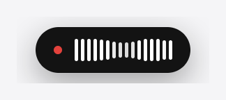
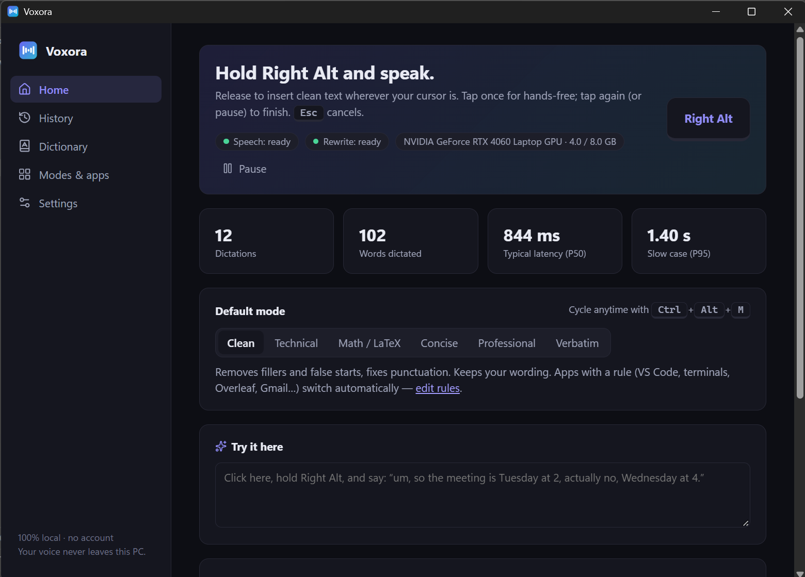
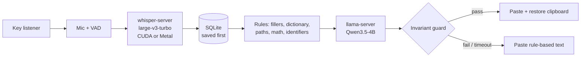

<p align="center">
  
</p>

<h1 align="center">Voxora</h1>

<p align="center">
  Hold a key, speak, let go. Clean text appears in whatever app you're typing in.<br>
  Speech recognition and AI cleanup run on your own computer. No account, no subscription, no audio leaves your machine.
</p>

<p align="center">
  <a href="https://github.com/ParshvCrafts/Voxora/actions/workflows/ci.yml"></a>
  <a href="LICENSE"></a>
  
</p>

<p align="center">
  
</p>

Voxora is free, MIT-licensed dictation for Windows and macOS that runs entirely on your
computer, including the optional AI rewrite: no account, no cloud, no word limits. It is built for
people who dictate into code editors, AI chats and LaTeX as often as into email: it keeps
`snake_case` identifiers intact, knows that "FAISS" is not "phaistense", resolves "Tuesday at
2, actually no, Wednesday" to Wednesday, and turns *"sigma from i equals 1 to n of x sub i"*
into `\sum_{i=1}^{n} x_i`. How it compares with Handy, OpenWhispr, Wispr Flow and others, with
sources and where they are ahead: [docs/COMPARISON.md](docs/COMPARISON.md).

## What it does

- **One key, two gestures.** Hold Right Alt (Right Option on a Mac) to talk; tap it to keep
  listening hands-free until you pause. `Esc` cancels. The floating HUD never takes focus away
  from the app you're typing in.
- **Modes that follow the app.** Clean, Technical, Math/LaTeX, Concise, Professional,
  Verbatim. VS Code and Cursor switch to Technical, Overleaf to Math, Mail and Outlook to
  Professional, using only the app's name (and, on Windows, its window title).
- **Spoken code, paths and math.** "dash dash maxfail equals 1" becomes `--maxfail=1`;
  "https colon slash slash api dot example dot com" becomes a URL; "O of V plus E log V" becomes
  `O(V + E log V)`; spoken math renders as Unicode (`θᵀx + b ≥ 0`) or LaTeX
  (`-\frac{1}{N} \sum_{i=1}^{N} y_i`).
- **Spoken editing.** "scratch that", "quote ... end quote", "new line", a final "period", and
  "first, ... second, ..." turning into a numbered list.
- **AI cleanup that can't change your facts.** A local LLM removes fillers and resolves
  self-corrections, then an invariant guard rejects any rewrite that adds or drops a number or
  identifier, introduces a name you never said, or answers your question instead of
  transcribing it. Rejected rewrites fall back to the rule-based text.
- **Nothing gets lost.** Every transcript is saved to SQLite before it is pasted (unless you turn
  history off). Your clipboard
  (text or image) comes back after the paste. If the target blocks synthetic keystrokes (admin
  windows on Windows, Secure Keyboard Entry on macOS), the text waits on the clipboard and the
  HUD tells you.
- **Your vocabulary.** Words you add steer Whisper toward your spelling and fix casing afterwards
  ("lang graph" becomes LangGraph); phrase shortcuts expand into longer text.

<p align="center">
  
</p>

## How it works



- **Rust + Tauri 2.** One engine, with four small OS modules swapped per platform: keyboard
  listener (Win32 low-level hook / macOS CGEventTap), paste (SendInput / CGEvent with
  NSPasteboard), foreground app, and the non-activating HUD window. Audio goes through `cpal`
  (WASAPI / CoreAudio), with the pure-Rust [earshot](https://crates.io/crates/earshot) VAD.
- **Inference runs in whisper.cpp and llama.cpp servers** that Voxora starts and supervises on
  `127.0.0.1`. Windows uses the official CUDA builds. On macOS, llama.cpp's official Metal build
  is downloaded, and `whisper-server` (which has no official macOS binary) is compiled from a
  pinned tag in CI and shipped inside `Voxora.app`. Any OpenAI-compatible server (Ollama, LM
  Studio) can replace the built-in rewrite engine.
- **The LLM is optional by design.** Short, fluent speech skips it (the rules finish in under a
  millisecond), and a timeout or guard rejection also falls back to the rules. LLM decoding is greedy,
  so the same transcript gives the same rewrite every time.
- **Measured, not assumed.** Every default has a benchmark behind it in the
  [decision log](docs/DECISIONS.md), including ideas that were tried and dropped.

More: [docs/ARCHITECTURE.md](docs/ARCHITECTURE.md).

## Results

Measured on a Lenovo Legion 5i (i9-14900HX, RTX 4060 Laptop 8 GB, Windows 11). Full tables and
how to reproduce them: [docs/BENCHMARKS.md](docs/BENCHMARKS.md).

| | Result |
|---|---|
| Core benchmark (30 cases: fillers, self-corrections, ML jargon, code, math, prompt injection), synthesized speech | **29/30 pass** (28/30 in a v0.2.3 re-run: Whisper misheard one jargon word) |
| Golden set, 20 hard edge cases (URLs, paths, nested LaTeX, quotes, lists, Big-O, accented names, noise), Voxora's pipeline on reference text (the noise-only case needs audio, so 19 are scored) | **19/19 key facts, 16/19 exact** |
| Same golden set as audio through Whisper, robotic Windows TTS voices | 11/20 key facts, 7/19 exact (misses are mishearings like "SHAD256" for SHA-256 and "QEN 2.53B" for Qwen3.5-2B) |
| Speech recognition, warm (whisper large-v3-turbo Q8, core benchmark) | P50 166 ms, P95 245 ms |
| AI rewrite when used (Qwen3.5-4B Q4_K_M, core benchmark) | P50 357 ms, P95 929 ms |
| End-to-end, key release to text in the app (real app, release build) | 0.45 to 0.77 s rule-based, 0.85 to 1.24 s with AI rewrite |
| Silence or keyboard noise only | nothing inserted |
| GPU memory, both models loaded | 4.3 GB of 8 GB |

## Install

### Windows 10/11

1. Download `Voxora_x.y.z_x64-setup.exe` from [Releases](https://github.com/ParshvCrafts/Voxora/releases) and run it.
   SmartScreen may warn because the installer is unsigned: click **More info**, then **Run anyway**.
2. On first launch the setup page shows exactly what this PC needs (about 4.7 GB with an NVIDIA
   GPU, 2.2 GB without one) and lets you skip the AI rewrite. Click **Download and start**.
   Voxora fetches pinned, SHA-256-verified builds of whisper.cpp, llama.cpp and the models,
   and checks first that the drive has room for them.
3. Click into any text field, hold **Right Alt**, speak, let go.

An NVIDIA GPU with about 5 GB free VRAM is recommended. Without one, Voxora uses CPU builds and a
smaller rewrite model, and you can skip the AI rewrite for instant rule-based cleanup (on the
setup page, or later in Settings).

The `.msi` on the release page is the same app as a Windows Installer package, for managed
installs. To check a download, compare `certutil -hashfile <file> SHA256` with
`SHA256SUMS.txt` on the release page. Voxora starts with Windows by default; turn that off in
Settings. Closing the window keeps it running in the tray; **Settings > Quit Voxora** stops it.

### macOS 13.3+ on Apple silicon (beta)

1. Download `Voxora_x.y.z_aarch64.dmg` from [Releases](https://github.com/ParshvCrafts/Voxora/releases)
   and drag Voxora to Applications.
2. Open it. macOS will refuse at first because the app is not notarized (that needs a paid Apple
   account). Go to **System Settings > Privacy & Security**, scroll down, and click
   **Open Anyway**. (Or run `xattr -dr com.apple.quarantine /Applications/Voxora.app` once.)
3. Voxora lives in the menu bar. The Home page shows **One permission to go**: click
   **Open System Settings** and turn Voxora on under **Accessibility**. That single permission
   lets it hear the dictation key and press Command+V for you. Allow the microphone when asked.
4. Click **Download and start** (about 3.6 GB), then hold **Right Option**, speak, let go.

### Shortcuts

| Windows | Mac | Action |
|---|---|---|
| Hold Right Alt | Hold Right Option | Dictate while held |
| Tap Right Alt | Tap Right Option | Hands-free; tap again or pause to finish |
| Esc | Esc | Cancel while listening |
| Ctrl+Alt+M | Control+Option+M | Switch mode |
| Ctrl+Alt+V | Control+Option+V | Paste the last dictation again |
| Ctrl+Z | Command+Z | The target app's own undo removes a paste (Voxora adds no undo of its own) |

### Updating

Download the new installer from [Releases](https://github.com/ParshvCrafts/Voxora/releases) and
run it over the current install; models, history and settings are kept. Your version is shown
under **Settings > About**. On macOS, replace the app in Applications, then turn Voxora off and
on again under **Accessibility** (macOS ties the permission to the exact app build).

### Uninstalling

Windows: **Settings > Apps > Installed apps > Voxora > Uninstall**. macOS: quit Voxora and move
it to the Trash. Either way, the downloaded models (about 5 GB), your dictation history and your
settings stay in the data folder until you delete it: `%LOCALAPPDATA%\Voxora` on Windows,
`~/Library/Application Support/Voxora` on macOS (**Settings > Open data folder** takes you there
before you uninstall).

### Build from source

```bash
# Rust, Node 22+, pnpm
pnpm install
pnpm tauri dev          # run
pnpm tauri build        # Windows: NSIS + MSI. macOS: .app + .dmg (see the macos job in ci.yml for whisper-server)
cargo test --workspace
```

Models and runtimes are not in the repo; the app downloads them on first run into
`%LOCALAPPDATA%\Voxora` (Windows) or `~/Library/Application Support/Voxora` (macOS).

## Status

Verified:
- 87 unit tests on Windows, and the same core suite plus macOS key-map tests on macOS (text
  pipeline, golden-case rules, math parser, guard, storage, gesture timing, resampling, archive
  safety), plus an opt-in live clipboard round-trip test on Windows (`cargo test -- --ignored`).
- Windows, on the hardware above: `scripts/e2e.ps1` drives the real app through a virtual audio
  cable (push-to-talk, hands-free auto-stop, Esc cancel, silence rejection, self-correction,
  spoken math, clipboard restore, dictating into Voxora's own window, Alt not left stuck),
  9/9 passing on v0.2.3. A force-killed Voxora leaves no inference server running.
- macOS, on GitHub's Apple silicon runners for every push: clippy and tests on the macOS code,
  `.app` and `.dmg` bundling, the bundled whisper-server transcribing a spoken sentence
  correctly (with the tiny English model, to keep CI fast), the pinned llama.cpp runtime passing
  its checksum and running, and the app launching, staying up, and installing its keyboard
  listener (the runner grants Accessibility).

Not yet verified:
- **macOS on a real Mac.** No Mac was available while building this. Holding the key, the HUD,
  pasting and clipboard restore follow Apple's documented APIs, but nobody has used them by hand
  yet. If you try it, please [open an issue](https://github.com/ParshvCrafts/Voxora/issues)
  with what worked.
- Elevated (admin) windows on Windows are handled by design and code review, not by an
  automated test.
- Benchmarks use synthesized voices, which are cleaner and stranger than a real microphone.
- Tested on one Windows machine; AMD and Intel GPUs fall back to CPU builds.

## Project layout

```
crates/voxora-core   text pipeline, math parser, guard, storage, engine clients, bench_eval
src-tauri            the app: audio, orchestrator, tray, IPC; Windows modules in src/, macOS in src/mac/
src                  React UI: main window and the HUD
bench                benchmark cases (core + golden) and results
scripts              benchmark audio, end-to-end test, README image capture
docs                 architecture, decisions, benchmarks, troubleshooting, research, original blueprint
```

Problems? See [docs/TROUBLESHOOTING.md](docs/TROUBLESHOOTING.md).

## Contributing

Bug reports, wrong dictations, Mac test reports and pull requests are all welcome. Start with
[CONTRIBUTING.md](CONTRIBUTING.md); planned work and good first issues are in
[docs/ROADMAP.md](docs/ROADMAP.md).

## License

MIT © Parshv Patel. Downloaded at runtime, not redistributed here:
[whisper.cpp](https://github.com/ggml-org/whisper.cpp) and
[llama.cpp](https://github.com/ggml-org/llama.cpp) (MIT; the macOS app bundles a whisper-server
built from whisper.cpp source),
[Whisper large-v3-turbo](https://huggingface.co/openai/whisper-large-v3-turbo) (MIT),
[Qwen3.5](https://huggingface.co/Qwen/Qwen3.5-4B) (Apache-2.0),
[Silero VAD](https://github.com/snakers4/silero-vad) (MIT).
The app bundles the [Inter](https://rsms.me/inter/) typeface (OFL).
