# Architecture

Voxora is a Rust/Tauri desktop app that supervises two local inference servers and runs a
deterministic text pipeline around them. Decisions and their evidence live in
[DECISIONS.md](DECISIONS.md); the original research blueprint is [BLUEPRINT.md](BLUEPRINT.md).

```mermaid
flowchart LR
  K[Key listener<br/>WH_KEYBOARD_LL / CGEventTap] --> G[Gesture state machine<br/>hold = PTT, tap = hands-free]
  G --> A[Mic capture<br/>cpal: WASAPI / CoreAudio]
  A -- 16 kHz frames --> V[earshot VAD<br/>level meter, auto-stop]
  A -- full clip, FFT resample --> W[whisper-server<br/>large-v3-turbo, CUDA / Metal]
  W --> F[Hallucination filter]
  F --> DB[(SQLite WAL<br/>raw text saved)]
  DB --> N[Stage 1: normalizer<br/>fillers, dictionary, math, identifiers]
  N --> L[Stage 3: llama-server<br/>Qwen3.5-4B, JSON schema]
  L --> GU[Stage 4: invariant guard]
  GU -- ok --> I[Clipboard paste<br/>SendInput + restore]
  GU -- violation / timeout --> I2[Stage 1 text]
  I2 --> I
  I --> DB2[(SQLite: final text, status, latency)]
```

## Crates

| Path | Role | Platform |
|---|---|---|
| `crates/voxora-core` | Normalizer, spoken-math parser, invariant guard, ASR filter, prompts, pipeline, gesture state machine, app-context rules, settings, SQLite store, whisper/LLM clients, sidecar supervisor, verified downloader, `bench_eval` | Any (no Win32) |
| `src-tauri` | Mic capture + VAD, tray, IPC commands, orchestrator (`engine.rs`), plus four OS modules: `hotkey`, `inject`, `target`, `winutil` | Windows, macOS |
| `src-tauri/src/mac/` | macOS versions of the four OS modules, selected with `#[cfg_attr(target_os = "macos", path = ...)]` | macOS |
| `src/` | React UI: main window and the HUD | WebView2 / WKWebView |

## Platforms

| Concern | Windows | macOS |
|---|---|---|
| Dictation key | `WH_KEYBOARD_LL` hook; swallows the key | Listen-only `CGEventTap` (never blocks keys) |
| Paste | Clipboard + `SendInput` Ctrl+V | `NSPasteboard` + `CGEvent` Command+V |
| Clipboard history opt-out | `ExcludeClipboardContentFromMonitorProcessing` etc. | `org.nspasteboard.TransientType` etc. |
| "Can't paste here" | Elevated target (UIPI) | Secure Keyboard Entry on |
| Foreground app | Process name + window title | App name only (titles need Screen Recording) |
| HUD | `WS_EX_NOACTIVATE`, click-through | `orderFrontRegardless`, ignores mouse, all Spaces |
| Child servers | Kill-on-close job object | PID file, orphans stopped on next launch |
| whisper-server | Official CUDA/CPU zip, downloaded | Built from source in CI, bundled in `Voxora.app` |
| Permissions | None | Accessibility (key + paste), Microphone |

## Lifecycle (src-tauri/src/engine.rs)

1. **Key down** → snapshot the foreground app (exe, title, elevation), resolve the mode from app
   rules, show the pill, open the mic. (Both servers are warmed once at startup; a per-dictation
   keep-warm was measured and dropped, see D9.)
2. **Key up / tap again / VAD silence** → close the mic (the Windows mic indicator turns off),
   FFT-resample to 16 kHz.
3. Less than 200 ms of voiced audio → "No speech detected", nothing sent anywhere.
4. **Transcribe** (whisper-server with its own Silero VAD and the user's glossary as the initial
   prompt). On failure: restart the server once and retry; if that fails, keep the audio in RAM
   for "Retry".
5. **Persist raw text** to SQLite (WAL, `synchronous=FULL`). From here, nothing can lose it.
6. **Rewrite**: deterministic normalizer always runs. The LLM runs only when it can add value
   (disfluencies, corrections, long utterances, or styles like Professional), under a timeout,
   with JSON-schema constrained output. The guard rejects any candidate that adds or drops
   numbers/identifiers, introduces proper nouns, or answers instead of rewriting.
7. **Insert**: if the focused window is elevated, leave text on the clipboard (UIPI would drop
   synthetic input silently). Otherwise snapshot the clipboard, paste, and restore after
   220 ms unless the clipboard sequence number changed.

## Failure handling

| Failure | Behaviour |
|---|---|
| LLM timeout, crash, bad JSON, guard violation | Insert Stage 1 text; restart llama-server in the background |
| GPU out of memory at start | Relaunch the server on CPU (`-ng` / `-ngl 0`) |
| whisper-server error mid-dictation | Restart once and retry; else keep audio for tray → Retry |
| Elevated target / paste failure | Text stays on clipboard, pill says so, row marked `clipboard_only` |
| Voxora crash | Servers are in a kill-on-close job object (no orphaned VRAM); text already in SQLite |
| Corrupt settings file | Moved aside to `settings.invalid.json`, defaults loaded |

## Privacy

The mic opens only while recording. Audio is never written to disk. Context detection reads the
foreground process name and window title only. Pasted text is tagged so Windows clipboard history
and cloud clipboard skip it. Servers bind to `127.0.0.1`. No telemetry.
